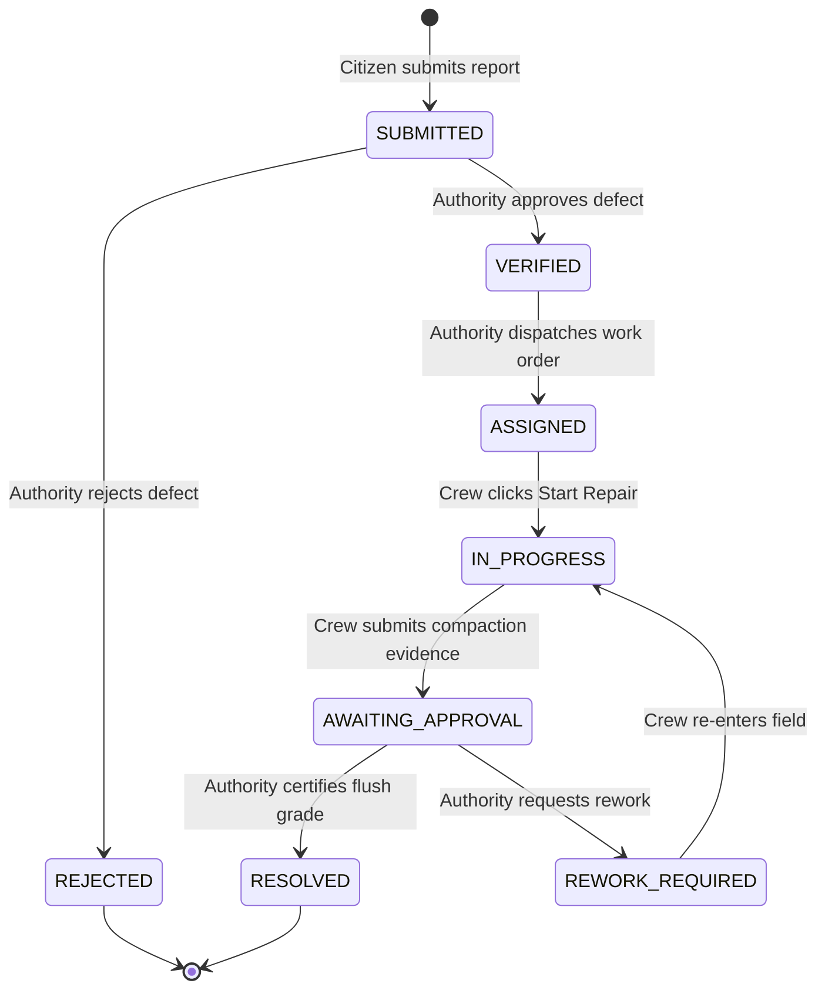

# PotholeFix — Full API Contract & Technical Specification

> **Status:** `PROPOSED & BACKEND-READY`  
> **Target Framework:** FastAPI (Python 3.10+)  
> **Auth Scheme:** Bearer JWT (`Authorization: Bearer <token>`)  
> **Base URL:** `http://localhost:8000` (Configurable via `VITE_API_BASE_URL`)  
> **Client Spec Version:** `2.4.0`

---

## 1. Global Standards & Data Formats

### 1.1 Authentication & Authorization
All authenticated routes require a standard HTTP Authorization header:
```http
Authorization: Bearer <jwt_access_token>
```
The JWT payload must contain:
```json
{
  "sub": "user_id_string",
  "email": "user@domain.com",
  "role": "CITIZEN" | "AUTHORITY" | "REPAIR_TEAM",
  "exp": 1793300000
}
```

### 1.2 Status State Machine
Reports and linked work orders strictly progress through the following statuses:



### 1.3 Timestamps & Enums
* **Date/Time:** ISO 8601 UTC format, e.g. `2026-10-29T14:20:00Z`.
* **Severity Levels:** `CRITICAL`, `HIGH`, `MODERATE`, `LOW`.
* **Priority Levels:** `HIGH`, `MEDIUM`, `LOW`.
* **Roles:** `CITIZEN`, `AUTHORITY`, `REPAIR_TEAM`.

### 1.4 AI Bounding Box Coordinate Format `[PROPOSED]`
* **Origin:** Top-left `(0, 0)`.
* **Dimension Units:** Normalized percentage (`0` to `100`), or normalized relative floats (`0.0` to `1.0`). The frontend handles both automatically.
```json
{
  "x": 22.5,
  "y": 35.0,
  "width": 54.0,
  "height": 48.0,
  "label": "severe-pothole",
  "confidence": 0.94
}
```

---

## 2. Authentication Endpoints

### 2.1 User Login
* **Endpoint:** `POST /auth/login`
* **Access:** Public
* **Content-Type:** `application/json`

#### Request Body
```json
{
  "email": "alex.rivera@community.org",
  "password": "password123"
}
```

#### Response `200 OK`
```json
{
  "token": "eyJhbGciOiJIUzI1NiIsInR5cCI6IkpXVCJ9...",
  "token_type": "Bearer",
  "expires_in": 86400,
  "user": {
    "id": "usr-8891",
    "name": "Alex Rivera",
    "email": "alex.rivera@community.org",
    "role": "CITIZEN",
    "avatar_initials": "AR"
  }
}
```

#### Error Responses
* `401 Unauthorized`: Invalid email or password.
* `422 Unprocessable Entity`: Missing required email or password fields.

---

### 2.2 User Registration
* **Endpoint:** `POST /auth/signup`
* **Access:** Public
* **Content-Type:** `application/json`

#### Request Body
```json
{
  "name": "Alex Rivera",
  "email": "alex.rivera@community.org",
  "password": "securePasscode123",
  "role": "CITIZEN"
}
```

#### Response `201 Created`
```json
{
  "token": "eyJhbGciOiJIUzI1NiIsInR5cCI6IkpXVCJ9...",
  "token_type": "Bearer",
  "expires_in": 86400,
  "user": {
    "id": "usr-8892",
    "name": "Alex Rivera",
    "email": "alex.rivera@community.org",
    "role": "CITIZEN",
    "avatar_initials": "AR"
  }
}
```

---

### 2.3 Current Session Profile
* **Endpoint:** `GET /auth/me`
* **Access:** Authenticated (`CITIZEN`, `AUTHORITY`, `REPAIR_TEAM`)

#### Response `200 OK`
```json
{
  "id": "usr-8891",
  "name": "Director Sarah Chen",
  "email": "s.chen@publicworks.gov",
  "role": "AUTHORITY",
  "title": "Director of Public Works",
  "department": "Dept of Public Works & Triage",
  "avatar_initials": "SC"
}
```

#### Error Responses
* `401 Unauthorized`: Token missing, invalid, or expired.

---

## 3. Computer Vision / YOLO Endpoint

### 3.1 Pothole Inference
* **Endpoint:** `POST /ai/detect`
* **Access:** Public or Authenticated
* **Content-Type:** `multipart/form-data`

#### Form Parameters
* `file`: Binary image file (`image/jpeg`, `image/png`, `image/webp` up to 10 MB).

#### Response `200 OK`
```json
{
  "detected": true,
  "confidence": 0.94,
  "severity": "CRITICAL",
  "boxes": [
    {
      "x": 20.5,
      "y": 30.0,
      "width": 58.0,
      "height": 52.0,
      "label": "severe-pothole",
      "confidence": 0.94
    }
  ]
}
```

#### Offline / Disconnected Behavior
If the YOLO model is offline or uninitialized, return HTTP 503 or an empty detection object `{ "detected": false, "confidence": 0, "severity": "LOW", "boxes": [] }`. The frontend cleanly renders an *"AI Model Not Connected"* notice without failing.

---

## 4. Reports Endpoints (`Citizen` & `Authority`)

### 4.1 Create Citizen Report
* **Endpoint:** `POST /reports`
* **Access:** Authenticated (`CITIZEN`)
* **Content-Type:** `multipart/form-data` OR `application/json`

#### Multipart Form Parameters
* `file`: Optional binary image file.
* `latitude`: Floating-point numeric, e.g. `43.6532`.
* `longitude`: Floating-point numeric, e.g. `-79.3832`.
* `address`: String street address, e.g. `"Bay St & Richmond St, Toronto, ON"`.
* `description`: String observation description.
* `ai_detection`: Optional serialized JSON string of detection results.

#### Response `201 Created`
```json
{
  "id": "PF-120",
  "tracking_number": "PF-120",
  "reporter_id": "usr-8891",
  "reporter_name": "Alex Rivera",
  "reporter_email": "alex.rivera@community.org",
  "created_at": "2026-10-29T14:20:00Z",
  "updated_at": "2026-10-29T14:20:00Z",
  "location": {
    "latitude": 43.6532,
    "longitude": -79.3832,
    "address": "Bay St & Richmond St, Toronto, ON"
  },
  "description": "Deep asphalt crater on driving lane.",
  "damage_image_url": "/static/uploads/pothole_120.jpg",
  "status": "SUBMITTED",
  "status_history": [
    {
      "status": "SUBMITTED",
      "timestamp": "2026-10-29T14:20:00Z",
      "note": "Citizen report logged with GPS coordinates.",
      "actor_name": "Alex Rivera"
    }
  ]
}
```

---

### 4.2 List Reports
* **Endpoint:** `GET /reports`
* **Access:** Authenticated (`AUTHORITY`, `REPAIR_TEAM`)
* **Query Parameters:**
  * `status`: Optional filter (`SUBMITTED`, `VERIFIED`, `ASSIGNED`, `IN_PROGRESS`, `AWAITING_APPROVAL`, `RESOLVED`, `REJECTED`)
  * `severity`: Optional filter (`CRITICAL`, `HIGH`, `MODERATE`, `LOW`)
  * `search`: Optional query string matching tracking number or address.

#### Response `200 OK`
```json
[
  {
    "id": "PF-098",
    "tracking_number": "PF-098",
    "location": {
      "latitude": 43.6532,
      "longitude": -79.3832,
      "address": "Bay St & Richmond St, Toronto, ON"
    },
    "damage_image_url": "/static/uploads/pf098.jpg",
    "status": "RESOLVED",
    "priority": "HIGH",
    "created_at": "2026-10-29T10:00:00Z"
  }
]
```

---

### 4.3 My Reports (Citizen View)
* **Endpoint:** `GET /reports/my`
* **Access:** Authenticated (`CITIZEN`)

#### Response `200 OK`
Returns an array of reports filed by the authenticated citizen.

---

### 4.4 Get Single Report Detail
* **Endpoint:** `GET /reports/{id}`
* **Access:** Authenticated (`CITIZEN`, `AUTHORITY`, `REPAIR_TEAM`)

#### Response `200 OK`
Complete `PotholeReport` object including `status_history`, `ai_detection`, `damage_image_url`, and `restored_image_url` (if resolved).

---

### 4.5 Verify or Reject Report
* **Endpoint:** `PATCH /reports/{id}/verify`
* **Access:** Authenticated (`AUTHORITY`)
* **Content-Type:** `application/json`

#### Request Body
```json
{
  "verified": true,
  "reason": "Class A arterial road defect confirmed by inspection."
}
```
*(If `verified: false`, `reason` is required).*

#### Response `200 OK`
Returns the updated `PotholeReport` with status transitioned to `VERIFIED` or `REJECTED`.

---

## 5. Work Order & Task Endpoints (`Authority` & `Repair Team`)

### 5.1 Assign Repair Crew (Create Work Order)
* **Endpoint:** `POST /tasks`
* **Access:** Authenticated (`AUTHORITY`)
* **Content-Type:** `application/json`

#### Request Body
```json
{
  "report_id": "PF-120",
  "tracking_number": "PF-120",
  "assigned_team_id": "team-04",
  "assigned_team_name": "Asphalt Unit 04 (Marcus Vance)",
  "priority": "HIGH",
  "deadline": "Tomorrow 17:00 EST",
  "instructions": "Cold saw-cut perimeter, flush compaction, clean debris."
}
```

#### Response `201 Created`
```json
{
  "id": "WO-94812",
  "report_id": "PF-120",
  "tracking_number": "PF-120",
  "assigned_team_id": "team-04",
  "assigned_team_name": "Asphalt Unit 04 (Marcus Vance)",
  "status": "PENDING",
  "priority": "HIGH",
  "deadline": "Tomorrow 17:00 EST",
  "instructions": "Cold saw-cut perimeter, flush compaction, clean debris.",
  "created_at": "2026-10-29T14:30:00Z"
}
```

---

### 5.2 My Assigned Tasks (Field Crew View)
* **Endpoint:** `GET /tasks/my`
* **Access:** Authenticated (`REPAIR_TEAM`)

#### Response `200 OK`
Array of work orders assigned to the authenticated crew unit.

---

### 5.3 Start Task (Crew On-Site)
* **Endpoint:** `PATCH /tasks/{id}/start`
* **Access:** Authenticated (`REPAIR_TEAM`)

#### Response `200 OK`
Returns `RepairTask` with status updated to `IN_PROGRESS` and `started_at` timestamp. Automatically transitions linked `PotholeReport` to `IN_PROGRESS`.

---

### 5.4 Submit Post-Repair Evidence
* **Endpoint:** `POST /tasks/{id}/completion`
* **Access:** Authenticated (`REPAIR_TEAM`)
* **Content-Type:** `multipart/form-data` OR `application/json`

#### Form Parameters / Request Body
* `file`: Binary image of the compacted smooth patch.
* `repair_notes`: Compaction depth and flushness description.

#### Response `200 OK`
Returns `RepairTask` with status `AWAITING_APPROVAL` and `after_repair_photo_url`. Automatically transitions linked report to `AWAITING_APPROVAL`.

---

### 5.5 Authority Approvals Queue
* **Endpoint:** `GET /authority/approvals`
* **Access:** Authenticated (`AUTHORITY`)

#### Response `200 OK`
Array of tasks with status `AWAITING_APPROVAL` ready for before/after comparison review.

---

### 5.6 Review Work Order (Approve / Request Rework)
* **Endpoint:** `PATCH /tasks/{id}/review`
* **Access:** Authenticated (`AUTHORITY`)
* **Content-Type:** `application/json`

#### Request Body (Approval)
```json
{
  "approved": true
}
```

#### Request Body (Rework Request)
```json
{
  "approved": false,
  "rework_reason": "Rough edge transition near curb. Re-roll flush."
}
```

#### Response `200 OK`
```json
{
  "task": {
    "id": "WO-94812",
    "status": "RESOLVED",
    "completed_at": "2026-10-29T15:00:00Z"
  },
  "notification_payload": {
    "event": "MUNICIPAL_REPAIR_RESOLVED",
    "work_order_id": "WO-94812",
    "report_id": "PF-120",
    "approved_at": "2026-10-29T15:00:00Z"
  }
}
```

---

## 6. Decisions Requiring Backend Confirmation `[PROPOSED]`

| Topic | Proposed Frontend Convention | Decision Needed From Backend Dev |
| :--- | :--- | :--- |
| **Bounding Box Format** | Normalized percentage `{ x, y, width, height }` | Confirm if YOLO returns normalized `0-1` floats or pixel absolute integers |
| **Image Storage** | Multipart uploads returning static CDN/local URLs (`/static/...`) | Confirm whether S3/GCS presigned URLs or direct FastAPI static mounts are used |
| **Field Crew Scoping** | `GET /tasks/my` filters by token user's `team_id` claim | Confirm if JWT includes `team_id` claim or if database handles lookup |
| **Email Event Handling** | Backend prepares and triggers asynchronous Celery/BackgroundTasks worker upon `RESOLVED` status | Confirm if frontend is expected to call any external email service (frontend handles zero email delivery) |
